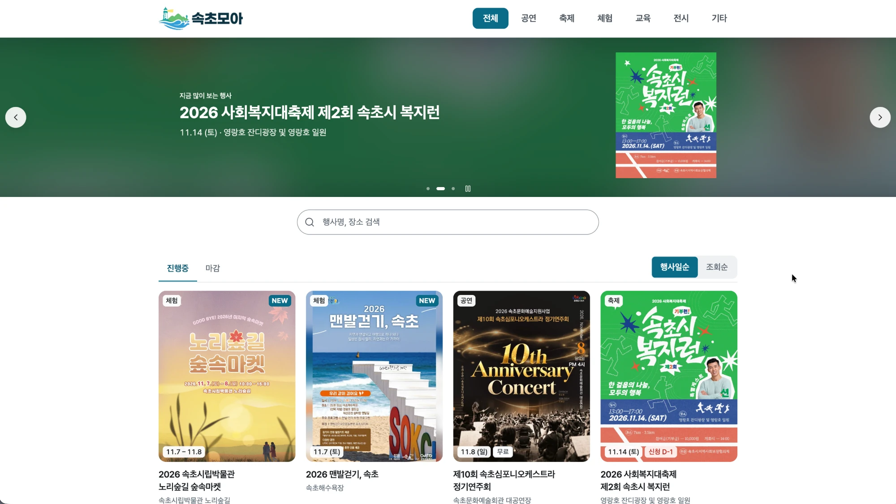
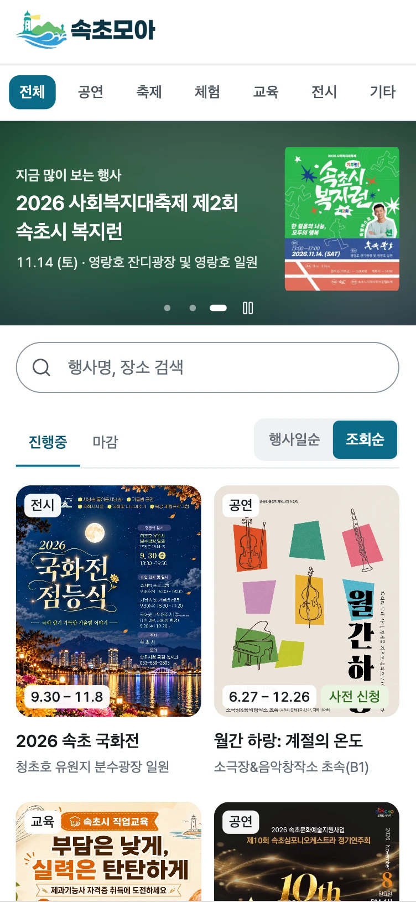
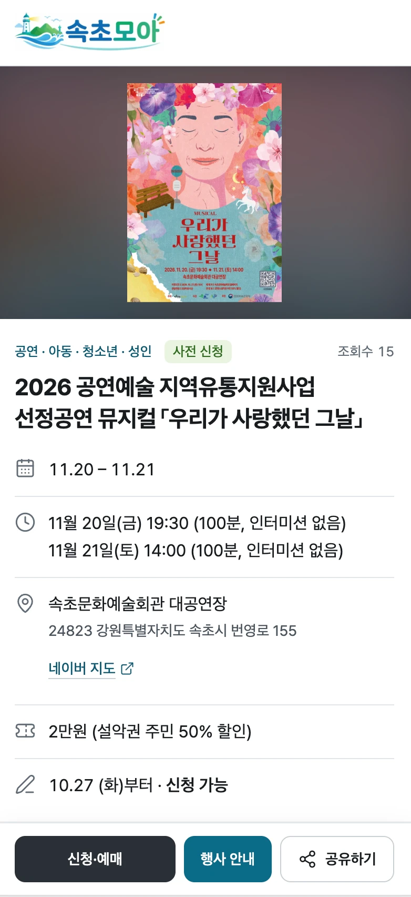
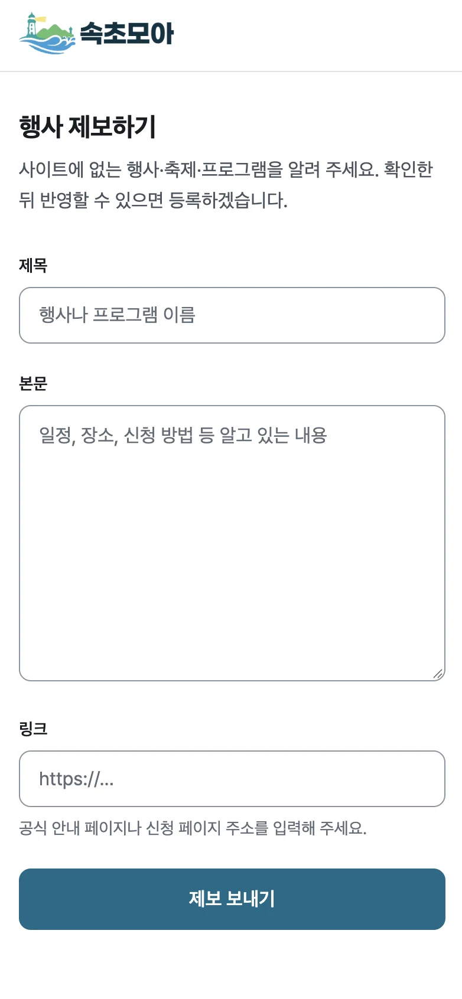
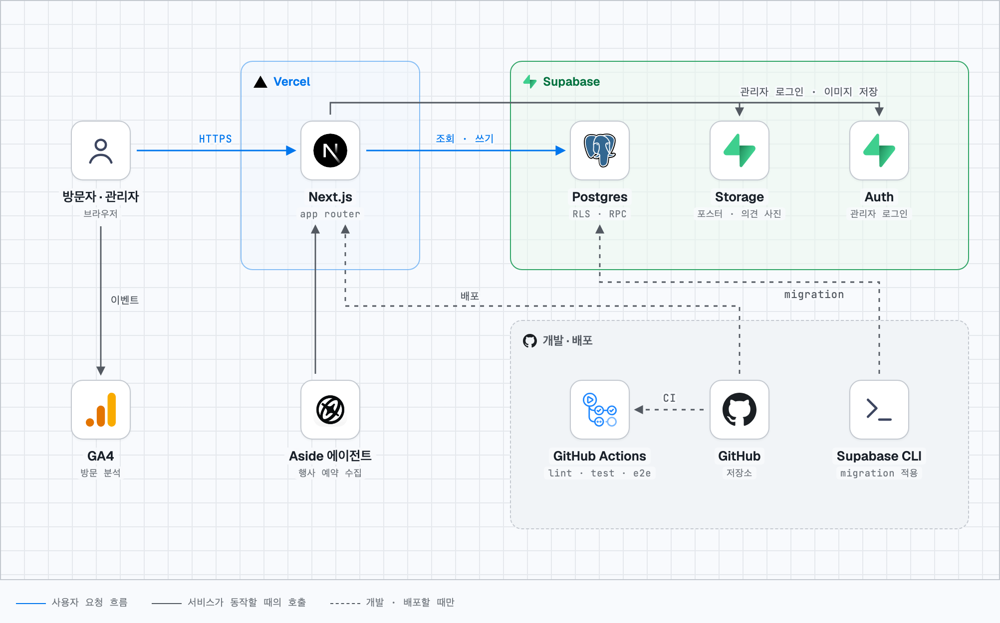
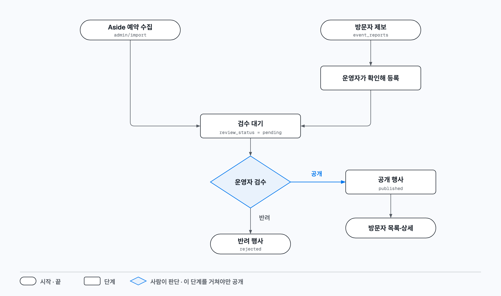
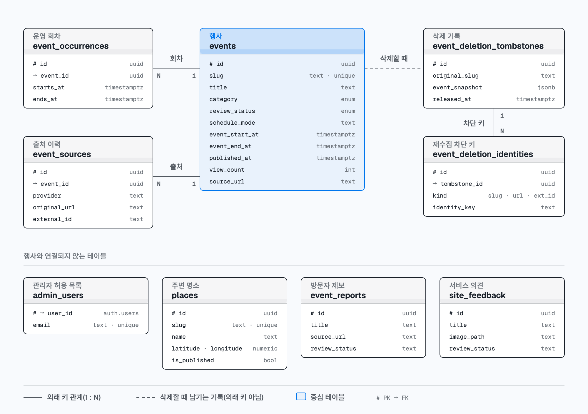

  

  속초의 공연·축제·체험·교육·전시를 한곳에서 찾는 지역 행사 서비스

  

  

## 서비스 소개

속초의 행사 정보는 시청, 문화시설, 도서관, 관광기관 등 여러 곳에 흩어져 올라와요.
원하는 행사를 찾으려면 기관마다 따로 확인해야 하고, 알게 됐을 땐 이미 신청이 끝난 경우도 많아요.

속초모아는 흩어진 행사를 한곳에 모아 **언제·어디서 열리는지, 지금 신청할 수 있는지**를 쉽게 확인하게 해 줘요.

## 속초모아가 주는 가치

| 사용자 문제 | 속초모아의 해결 방식 | 전달 가치 |
| --- | --- | --- |
| 행사 정보가 기관마다 흩어져 있다 | 공식 행사를 한곳에 모아 분야별로 보여 줌 | 한곳에서 찾기 |
| 알게 됐을 땐 이미 마감됐다 | 오늘 마감·신청 D-N 배지로 남은 시간을 알려 줌 | 놓치지 않기 |
| 공식 안내문은 내용이 길어 날짜·장소·요금·신청 방법을 바로 찾기 어렵다 | 상세 화면에 필요한 정보만 골라 보기 좋게 정리 | 빠른 확인 |
| 새 행사는 계속 생기는데 정보가 늦거나 틀리기 쉽다 | AI Agent가 꾸준히 수집하고 사람이 원문과 대조해 검수 | 최신이면서 정확한 정보 |

## 주요 기능

  
  &nbsp;
  
  &nbsp;
  

홈 · 행사 상세 · 행사 제보

| 기능 | 설명 |
| --- | --- |
| 🗓️ 행사 모아보기 | 여러 기관에 흩어진 속초 행사를 한곳에서 모아 봐요. |
| ⏰ 마감 배지 | 오늘 마감·신청 D-N이 자동으로 붙어, 끝나거나 마감되기 전에 알아챌 수 있어요. |
| 🔥 지금 많이 보는 행사 | 요즘 많이 찾는 행사를 홈 상단 배너로 보여 줘요. |
| 📍 행사 상세 | 기간·장소·요금·신청 방법 등 행사 정보를 보기 좋게 정리했어요. |
| ✉️ 행사 제보 | 사이트에 없는 행사를 방문자가 알려 주면, 운영자가 확인해 등록해요. |
| 🤖 Agent 수집 · 사람 검수 | AI Agent가 새 행사를 꾸준히 모으고, 사람이 원문과 대조해 정확한 행사만 공개해요. |

## 아키텍처

<picture>
  <source media="(prefers-color-scheme: dark)" srcset="./docs/images/stack-diagram-dark.png" />
  
</picture>

- **읽기**: 서버 컴포넌트가 공개 행사 전체를 한 번 불러와 캐시하고, 필터·정렬은 메모리에서 해요. 브라우저는 Supabase를 직접 부르지 않아요.
- **쓰기**: server action이 입력을 검증하고, DB의 RLS·RPC가 권한을 한 번 더 검사해요.

### 기술 스택

| 분류 | 기술 |
| --- | --- |
| 웹 |      |
| 데이터 |   |
| 테스트 |    |
| 배포·운영 |    |

### 행사가 공개되기까지

<picture>
  <source media="(prefers-color-scheme: dark)" srcset="./docs/images/publish-flow-dark.png" />
  
</picture>

### 데이터 모델

<picture>
  <source media="(prefers-color-scheme: dark)" srcset="./docs/images/data-model-dark.png" />
  
</picture>
