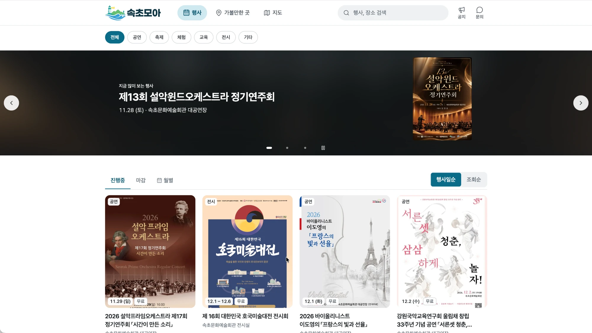
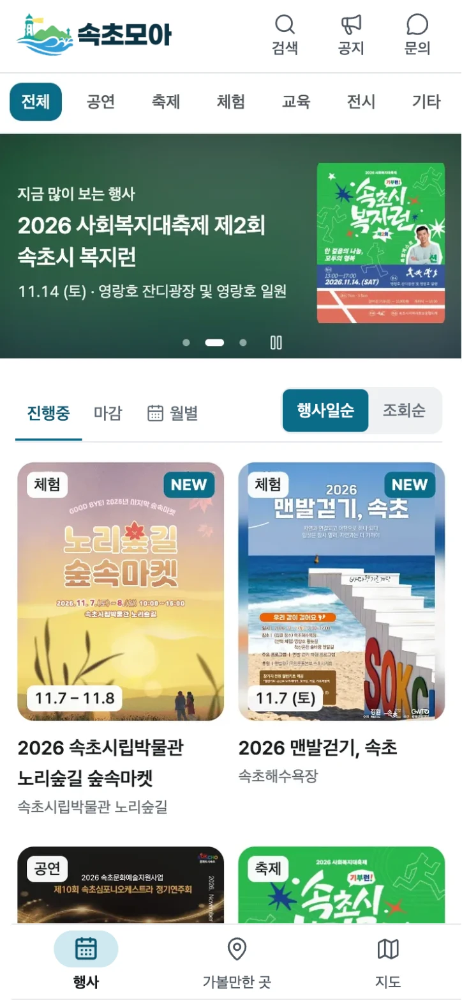
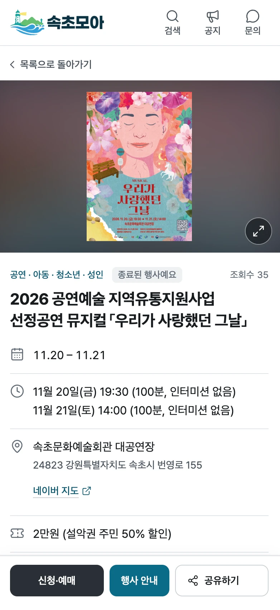
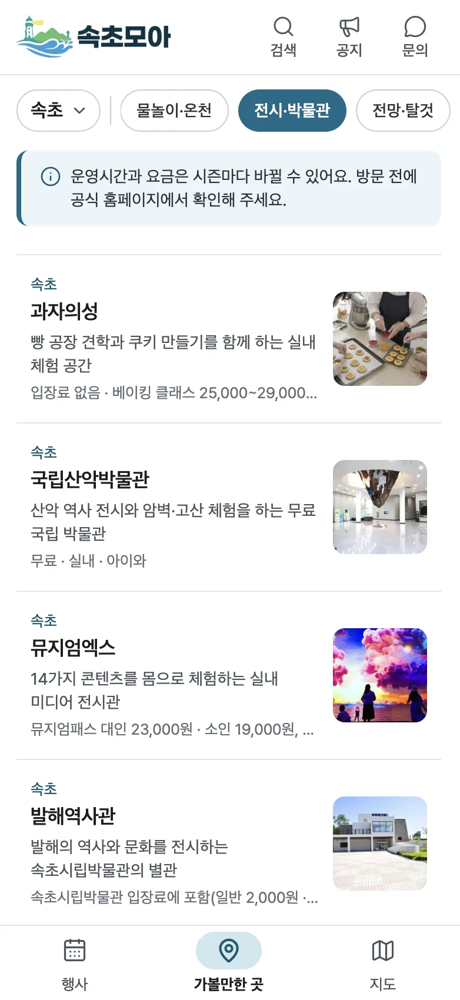
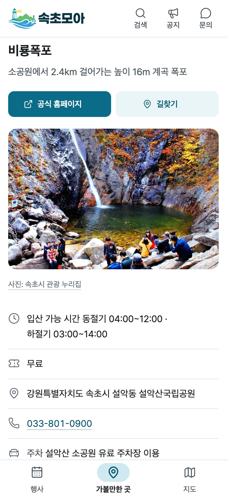
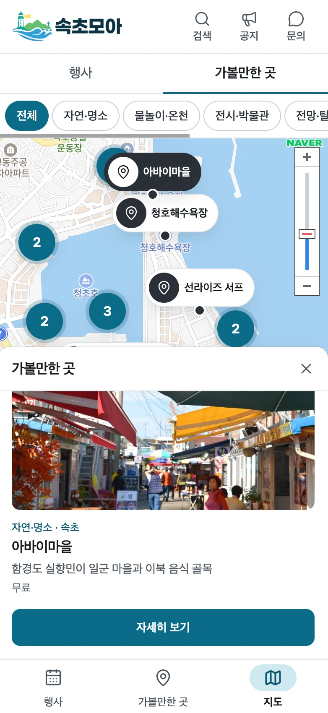
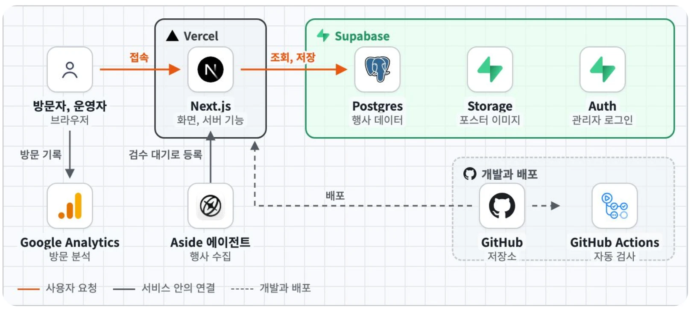

  

  속초에서 뭐 하고 즐길지, 행사와 가볼만한 곳을 한곳에서 둘러보는 지역 정보 서비스

  

  

## 서비스 소개

**🗓️ 흩어진 행사를 한곳에서**

속초의 행사 정보는 시청, 문화시설, 도서관, 관광기관 등 여러 곳에 흩어져 올라와요.
따로 찾아보기 번거로워서 건물 홍보물이나 현수막을 보고 우연히 알게 되는 일이 많고, 그땐 이미 신청이 끝난 경우도 있어요.
속초모아에서는 흩어진 행사를 한곳에서 보고, **언제·어디서 열리는지, 지금 신청할 수 있는지** 바로 알 수 있어요.

**🧭 몰랐던 가볼만한 곳까지**

인터넷에서 "속초 가볼만한 곳"을 검색하면 광고 글이나 늘 소개되는 몇 곳만 되풀이해서 나와요.
그 밖에 어떤 곳이 있는지, 잘 알려지지 않은 곳은 어디인지 알기 어려워요.
속초모아에서는 명소, 온천, 박물관, 체험 공간을 분류별로 모아 **어떤 곳들이 있는지 한눈에 둘러볼 수 있어요.**

**🗺️ 내 근처와 동선의 볼거리를 지도로**

지도에서는 지금 열리는 행사와 가볼만한 곳을 함께 볼 수 있어요.
주민은 동네 가까이에서 열리는 행사를, 여행자는 동선 위에 있는 가볼만한 곳을 한 번에 찾을 수 있어요.

## 속초모아가 주는 가치

| 사용자 문제 | 속초모아가 하는 일 | 가치 |
| --- | --- | --- |
| 행사 정보가 기관마다 흩어져 있어 따로 찾아보기 번거롭고, 건물 홍보물이나 현수막으로 우연히 알게 되는 경우가 많다 | 흩어진 공식 행사를 분야별로 한곳에 모아 보여 줌 | 지금 열리는 행사 한눈에 파악 |
| 검색하면 광고나 늘 나오는 몇 곳만 보여, 어떤 곳이 더 있는지 모른다 | 명소, 온천, 박물관, 체험 공간을 분류별로 모아 둘러볼 수 있게 함 | 새로운 갈 곳 발견 |
| 주민은 내 근처에, 여행자는 내 동선에 어떤 행사와 가볼만한 곳이 있는지 알기 어렵다 | 행사와 가볼만한 곳을 지도에서 함께 보여 줌 | 근처·동선의 볼거리 찾기 |
| 공식 사이트마다 따로 들어가 봐야 새 행사나 바뀐 일정을 알 수 있다 | AI Agent가 정기적으로 구석구석 수집하고, 바뀐 내용도 찾아내 반영 | 빠짐없는 최신 정보 |

## 주요 기능

<table align="center">
  <tr>
    <td align="center"> 행사 홈</td>
    <td align="center"> 행사 상세</td>
  </tr>
</table>

<table align="center">
  <tr>
    <td align="center"> 가볼만한 곳</td>
    <td align="center"> 가볼만한 곳 상세</td>
    <td align="center"> 지도</td>
  </tr>
</table>

| 기능 | 설명 |
| --- | --- |
| 🗓️ 행사 모아보기 | 여러 기관에 흩어진 속초 행사를 분야별로 한곳에서 보고, 마감이 가까운 행사는 배지로 미리 알 수 있어요. 상세에서는 일정·장소·요금·신청 방법을 확인하고 공식 안내 페이지로 바로 갈 수 있어요. |
| 🧭 가볼만한 곳 | 속초의 명소와 즐길 곳을 분류별로 모아, 몰랐던 곳까지 둘러볼 수 있어요. |
| 🗺️ 지도 | 지금 열리는 행사와 가볼만한 곳을 지도에서 함께 보고, 고른 곳의 정보를 바로 열어 볼 수 있어요. |
| 🤖 AI 자동 수집 | AI Agent가 예약된 일정마다 시청·문화시설·도서관 같은 공식 기관 사이트를 돌며 새 행사와 바뀐 내용을 모아 와요. 사람이 일일이 찾아 입력하지 않아도 행사 정보가 꾸준히 채워져요. |

## 아키텍처

  

### 기술 스택

| 분류 | 기술 |
| --- | --- |
| 웹 |      |
| 데이터 |   |
| 테스트 |    |
| 배포·운영 |    |
