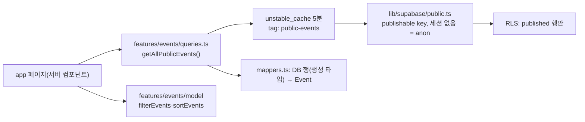
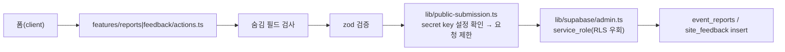
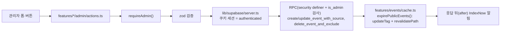

# 구조 지도

속초모아 코드가 어떻게 나뉘고 데이터가 어떻게 흐르는지 정리한 문서입니다. 코드와 실제 실행(로컬 Supabase, pgTAP, E2E)으로
확인한 사실만 적습니다. 코드를 바꾸면 이 문서도 함께 고칩니다.

## 한 문장 요약

공개 화면은 서버 컴포넌트가 **공개 행사 전체를 한 번 불러와 5분 캐시하고 메모리에서 거르며**, 쓰기는 **server action**이
맡습니다. 방문자 쓰기는 서버가 검증·요청 제한을 한 뒤 secret key client로, 관리자 쓰기는 로그인 세션 client로 하고
DB의 RLS·RPC가 다시 권한을 검사합니다.

---

## 폴더

```text
app/                 URL과 1:1. 데이터 함수 호출 + feature 컴포넌트 조립
  _components/       전역 헤더(레이아웃 조각)
  admin/_components/ 관리자 shell(로그아웃 버튼 포함)
features/
  events/            행사 탐색·상세·관리 (model, queries, cache, mappers, seo, components, admin/)
  places/            주변 명소 (model, queries, cache, mappers, components, admin/)
  reports/           방문자 행사 제보 (schemas, actions, components, admin/)
  feedback/          방문자 서비스 의견 (schemas, actions, components, admin/)
  auth/              관리자 로그인·로그아웃
components/          여러 feature가 쓰는 UI (ui/, layout/, admin/, analytics/)
lib/                 도메인을 모르는 인프라
  supabase/          client 세 종류 + 생성 타입(database.types.ts)
  auth/admin.ts      requireAdmin(관리자 확인)
  env.ts, env.server.ts  공개·서버 환경 변수 검증
  public-submission.ts, rate-limit.ts  방문자 제출 관문과 요청 제한
  action-state.ts, form-data.ts        action 반환 형태와 폼 값 helper
  seo/, analytics/   사이트 전체 SEO·GA4
supabase/            migrations, seed.sql, tests/database(pgTAP), rollbacks, config.toml
tests/               unit/(Vitest), e2e/(Playwright, 로컬 Supabase)
proxy.ts             없는 토픽 404, 관리자 세션 갱신
```

의존 방향은 `app → features → components, lib` 한 방향입니다. feature끼리는 다른 feature의 `model`(타입·순수 함수)만
import합니다. 이 규칙은 아직 lint로 강제하지 않습니다.

---

## 라우트

렌더링: 정적(빌드 때 생성) / ISR(정적으로 만들고 일정 시간마다 다시 생성) / 동적(요청마다 생성). `pnpm build` 출력 기준입니다.

| 경로 | 렌더링 | 조립하는 것 |
| --- | --- | --- |
| `/` | 동적(`searchParams`) | `features/events/components/event-browse-page` + `getAllPublicEvents` |
| `/topics/[topic]` | 동적 | 위와 같음. 카테고리 SEO 페이지 6개. 없는 토픽은 `proxy.ts`가 404 |
| `/events/[slug]` | ISR 1시간, 공개 행사 전부 미리 생성 | 행사 상세, 관련 행사, 주변 명소(`features/places/queries`) |
| `/calendar` | 동적 | 목록으로 redirect만(캘린더는 삭제, 옛 북마크 보호) |
| `/report`, `/feedback` | 정적 | 방문자 제보·의견 폼 |
| `/admin/**` | 동적(쿠키) | 모든 페이지가 `requireAdmin()`으로 시작 |
| `POST /api/events/[slug]/view` | 동적 | 조회수 +1 RPC |
| `POST /api/revalidate` | 동적 | 외부 수집기용 캐시 무효화(Bearer 비밀값, timing-safe 비교) |
| `/sitemap.xml` | ISR 5분(`revalidate = 3600`이지만 안에서 쓰는 데이터 캐시 5분을 따름) | 검색엔진용 |
| `/robots.txt`, `/indexnow-key.txt`, `/manifest.webmanifest` | 정적 | 검색엔진·PWA용 |

---

## 데이터 흐름

### 공개 조회



- 행사 수가 적어 전체 목록 하나만 캐시하고 필터·정렬은 메모리에서 합니다. 조건별 캐시는 적중률만 떨어뜨립니다.
- `unstable_cache`는 Next.js 16에서 `use cache`로 대체 예정이지만, 배포를 넘어 유지되는 특성 때문에 유지합니다.

### 방문자 쓰기(제보·의견)



- 방문자는 DB에 직접 쓸 수 없습니다(anon insert 권한 회수, pgTAP으로 확인). 서버만 저장하므로 검증·요청 제한이 방어선입니다.
- 요청 제한은 IP를 HMAC으로 바꿔 DB 카운터에 기록하고, 확인에 실패하면 거부합니다(fail closed).

### 관리자 쓰기



- 행사 저장은 행사·회차·출처를 RPC 하나로 처리합니다. 행사 삭제는 DB가 직접 delete를 막아 RPC로만 되고, 재수집 제외 기록을 남깁니다.
- 저장 직후 캐시는 `updateTag`로 즉시 만료합니다(이전 `revalidateTag(…, "max")`는 저장한 사람에게 옛 값을 먼저 보여 줬음).

### Supabase client 세 종류

| 파일 | 키 | DB 역할 | 쓰는 곳 |
| --- | --- | --- | --- |
| `lib/supabase/public.ts` | publishable, 세션 없음 | `anon` | 캐시되는 공개 조회, 조회수 |
| `lib/supabase/server.ts` | publishable + 쿠키 | 로그인 시 `authenticated` | 관리자 조회·쓰기, 로그인 |
| `lib/supabase/admin.ts` | secret | `service_role`(RLS 우회) | 방문자 제보·의견 저장, 요청 제한 |

세 파일 모두 `server-only`이고 `Database` 생성 타입을 씁니다. 브라우저는 Supabase를 직접 부르지 않습니다.

---

## 테이블과 권한

pgTAP(`supabase/tests/database/`)으로 실제 권한을 확인했습니다. 정의는 `supabase/migrations/`가 원본입니다.

| table | 방문자(anon) | 관리자 | 확인한 방법 |
| --- | --- | --- | --- |
| `events` | 공개 행만 읽기. 수정은 오류 없이 0행 | 읽기·추가·수정. **직접 delete 불가**(RPC만) | `01_public_access`, `03_event_admin_rpc` |
| `event_reports`, `site_feedback` | 직접 insert 불가(권한 오류), 조회는 0행 | 상태 변경·삭제 | `01_public_access` |
| `public_submission_rate_limits`(private) | 함수 실행 불가 | 함수 실행 불가(서버만) | `02_rate_limit` |
| `event_deletion_*` | 없음 | 읽기만(쓰기는 RPC) | `03_event_admin_rpc` |

Supabase는 table 권한(grant)을 기본으로 넓게 줍니다. 그래서 select·update를 막는 것은 grant가 아니라 RLS이고, 이때는 오류 대신
"0행"이 됩니다. insert는 migration이 grant를 직접 회수해서 권한 오류가 납니다.

---

## 테스트

| 층 | 도구 | 무엇을 보장하나 | 실행 |
| --- | --- | --- | --- |
| 도메인 규칙·action 분기 | Vitest(`tests/unit`) | 상태 계산, 필터·정렬, URL 정규화, 방문자 제출 순서 | `pnpm test` |
| DB 권한·RPC | pgTAP(`supabase/tests/database`) | RLS·grant, 관리자 RPC, 요청 제한, 재수집 제외 | `pnpm db:test` |
| 사용자 흐름 | Playwright(`tests/e2e`) | production build + 로컬 Supabase seed로 공개 화면·제보·관리자 화면 | `pnpm test:e2e` |

E2E는 로컬 Supabase 주소가 아니면 시작하지 않습니다(`tests/e2e/local-supabase.ts`).
