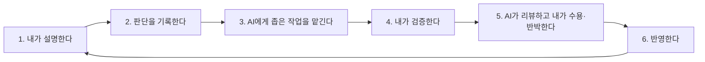

# 영역별 재구축 루프

속초모아는 AI로 빠르게 만든 코드베이스입니다. 이 문서는 그 코드를 **내가 설명하고 검증할 수 있는
코드**로 다시 세우는 방법을 정합니다. 핵심은 AI가 혼자 고치지 않고, 내가 이해하고 판단한 결과만
코드에 남기는 것입니다.

AI가 지켜야 할 규칙은 [RULES.md의 재구축 원칙](../../.ai/RULES.md#재구축-원칙)이 원본입니다.

## 영역과 순서

아래로 갈수록 앞 영역에 의존합니다. 앞 영역을 이해하지 않고 뒤 영역을 고치면, 권한·데이터 계약을
모른 채 화면만 바꾸게 됩니다.

| 순서 | 영역 | 범위(시작 파일) | 이 영역에서 답할 질문 | 관련 후보 | 상태 |
| --- | --- | --- | --- | --- | --- |
| 1 | 데이터 모델·RLS | `supabase/migrations/`, `supabase/tests/`, `lib/supabase/` | 어떤 table이 있고, 누가 무엇을 읽고 쓸 수 있는가? client 세 종류는 각각 언제 쓰는가? | 2, 8, 9, 10 | 시작 전 |
| 2 | 도메인 규칙 | `features/*/model/` | 행사 "상태"(진행 중·예정·마감)와 신청 상태는 어떻게 계산하는가? 날짜는 어느 시간대 기준인가? | 4 | 시작 전 |
| 3 | 공개 조회 | `features/*/queries.ts`, `features/*/cache.ts`, `app/(event-browse)/`, `app/events/[slug]/`, `app/sitemap.ts` | 어떤 데이터를 언제 캐시하고, 언제 다시 불러오는가? | 3, 5, 6 | 시작 전 |
| 4 | 제보·요청 제한 | `features/reports/`, `features/feedback/`, `lib/public-submission.ts`, `lib/rate-limit.ts` | 로그인 없는 사용자의 쓰기를 무엇으로 막는가? | - | 시작 전 |
| 5 | 관리자 | `features/*/admin/`, `app/admin/`, `lib/auth/`, `components/admin/` | 관리자 쓰기는 어떤 순서로 검증·저장·무효화되는가? | 1, 7 | 시작 전 |

상태 값: 시작 전 → 설명 중 → 결정 중 → 작업 중 → 검증 중 → 완료

## 한 영역에서 도는 루프

각 영역에서 아래 6단계를 순서대로 돕니다. 한 바퀴에 하나의 좁은 질문이나 변경만 다룹니다.
한 영역에서 여러 바퀴를 돌 수 있습니다.

### 1. 설명

- **누가**: 나
- **무엇을**: [architecture.md](../architecture.md)의 해당 영역을 읽고, 코드가 무엇을 하는지 내 말로 씁니다.
  결정 문서의 "내 설명" 칸에 씁니다.
- **AI의 역할**: 내가 쓴 설명을 코드와 대조해 틀린 곳을 `파일:라인`으로 짚습니다. 설명을 대신 쓰지 않습니다.
- **끝나는 조건**: 이 영역의 "답할 질문"에 코드를 보지 않고 답할 수 있다.
- 설명하다 이유를 모르는 코드를 만나면 "이유 확인 필요"로 남기고 넘어갑니다. 지어내지 않습니다.

### 2. 판단 기록

- **누가**: 나
- **무엇을**: 유지·삭제·변경 중 무엇을 할지, 왜 그렇게 하는지 [`docs/decisions/`](../decisions/README.md)에
  기록합니다. 고르지 않은 대안과 그 이유도 적습니다.
- **필요하면**: GA4, Search Console 수치를 확인해 근거로 붙입니다.
- **끝나는 조건**: 결정 문서의 상태가 `결정됨`이고, AI에게 맡길 작업 범위가 문서에 적혀 있다.

### 3. AI에게 좁은 작업 맡기기

- **누가**: 내가 맡기고 AI가 작업
- **맡기는 방법**: 결정 문서를 링크하고, 바꿔도 되는 파일과 완료 조건을 적습니다.
  예: "D-0003에 따라 `lib/supabase/browser.ts`를 삭제해. 다른 파일은 바꾸지 마. 완료 조건: lint·typecheck 통과."
- **좁다의 기준**: 한 PR로 리뷰할 수 있고, 되돌릴 때 다른 결정에 영향을 주지 않는다.
- AI는 범위 밖에서 문제를 발견하면 고치지 않고 보고합니다.

### 4. 검증

- **누가**: 나
- **무엇으로**: [RULES.md의 검증 표](../../.ai/RULES.md#검증-및-완료)에 따른 명령, 그리고 화면·수치.
- **기록**: 실행한 명령과 결과, 화면으로 확인한 것, 확인하지 못한 것(예: Supabase 경로)을 결정 문서의
  "검증 결과"에 적습니다. AI가 "통과했다"고 보고한 것을 그대로 옮기지 않고 내가 다시 실행합니다.

### 5. AI 리뷰와 수용·반박

- **누가**: AI가 [REVIEW.md](../../.ai/review/REVIEW.md) 기준으로 리뷰하고, 내가 지적마다 판단합니다.
- 판단은 셋 중 하나입니다.
  - **수용**: 맞는 지적. 고칩니다.
  - **반박**: 틀린 지적. 왜 틀렸는지 근거(코드·결정 문서)를 적습니다.
  - **보류**: 지금 범위 밖. 다음 바퀴나 다른 영역의 질문으로 넘깁니다.
- 판단 결과를 결정 문서의 "리뷰 기록"에 남깁니다.

### 6. 반영

리뷰 결과 중 다음 작업에도 영향을 주는 것만 문서로 옮깁니다.

| 리뷰 결과 | 반영할 곳 |
| --- | --- |
| 수용 + 앞으로도 지켜야 할 규칙 | [`.ai/CONVENTIONS.md`](../../.ai/CONVENTIONS.md) |
| 반박 + 같은 조건에서 다시 나올 수 있는 지적 | [`.ai/review/false-positives.md`](../../.ai/review/false-positives.md) |
| 리뷰가 놓친 문제를 내가 찾음 | [`.ai/review/REVIEW.md`](../../.ai/review/REVIEW.md)의 "반드시 지적할 것" |
| 한 번만 맞는 지적 | 코드만 고치고 문서에는 남기지 않음 |

영역의 모든 질문에 답했고 남은 후보가 결정되면, 위 표의 상태를 `완료`로 바꿉니다.

## 포트폴리오 근거로 남기는 것

이 루프의 기록 자체가 "AI로 만든 코드를 인수해 설명·검증할 수 있게 재설계했다"는 근거입니다.
그래서 아래를 지킵니다.

- 재구축 이전의 코드·결정은 "기존 구현"으로 적고, 내가 설계한 것처럼 쓰지 않습니다.
- 결정 문서에는 판단이 바뀐 과정(처음 생각 → 확인한 사실 → 바뀐 판단)을 남깁니다.
- AI 리뷰를 반박한 사례는 근거와 함께 남깁니다. 무엇을 AI에게 맡기고 무엇을 직접 판단했는지가 드러납니다.
- 수치는 측정한 것만 적습니다. 측정하지 않은 효과는 "확인 필요"로 둡니다.
